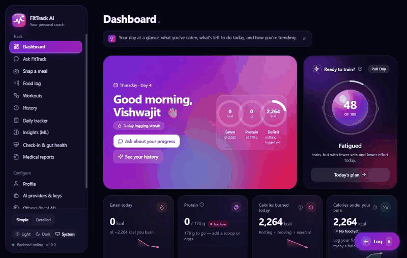
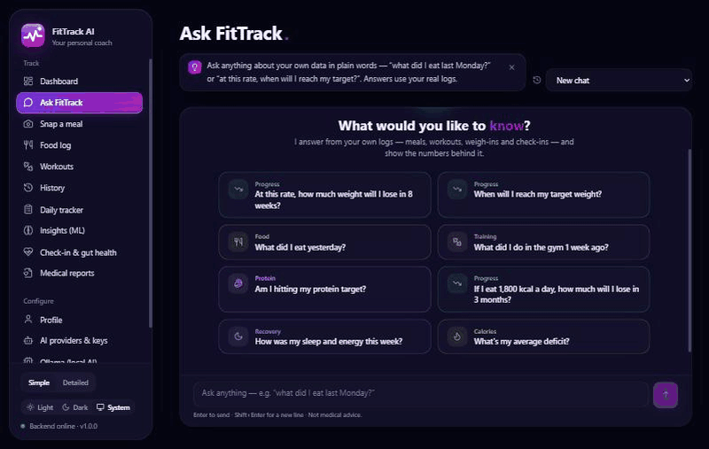
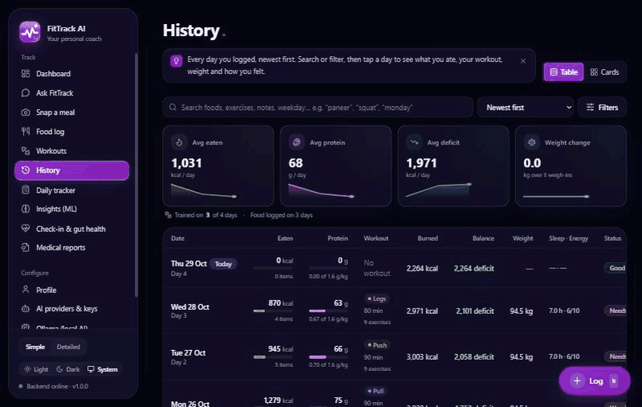
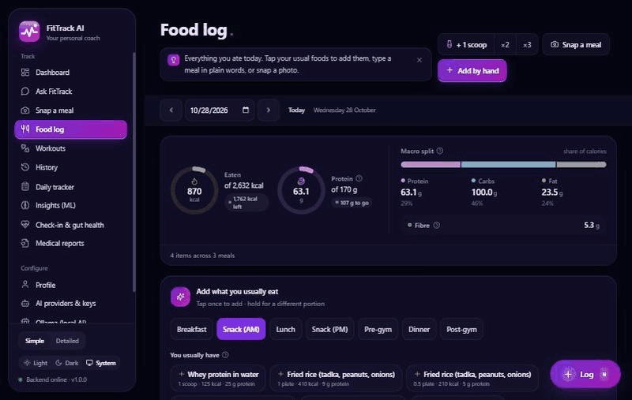
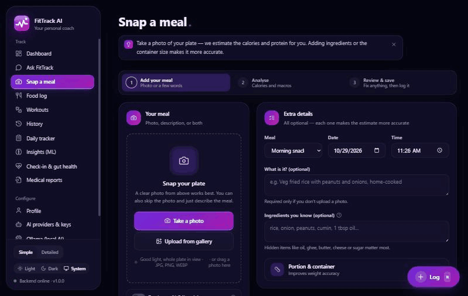
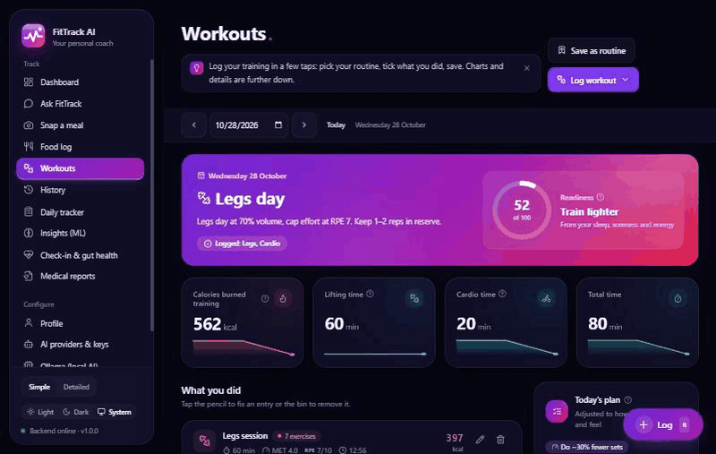
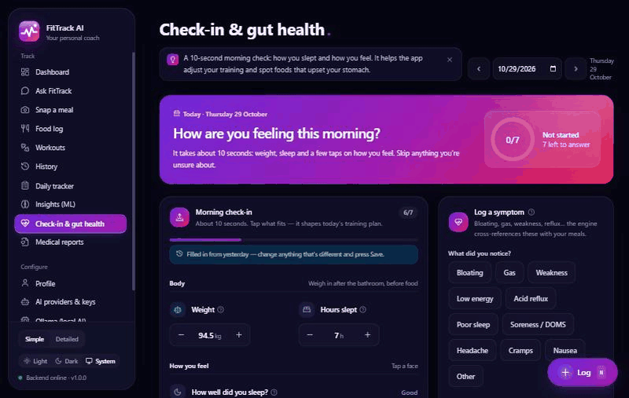
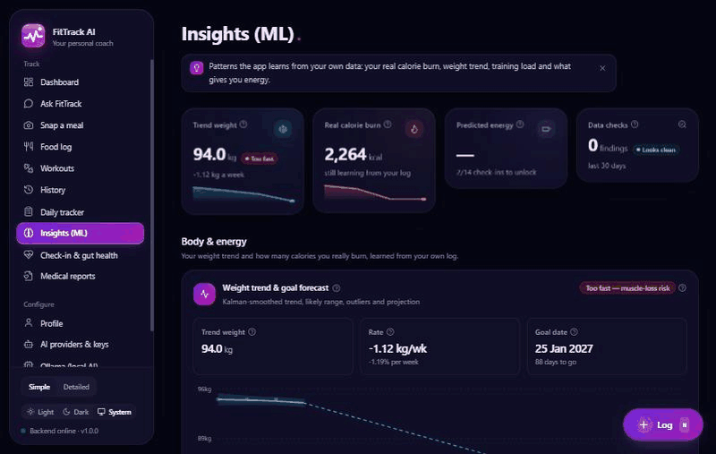
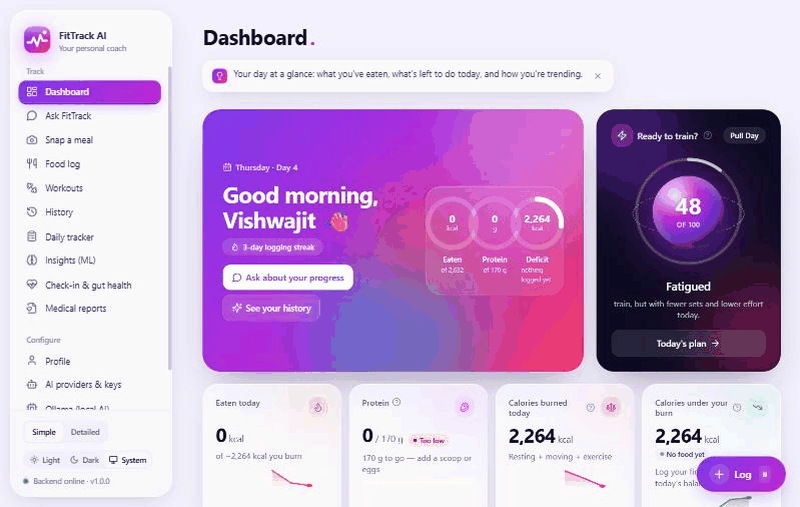
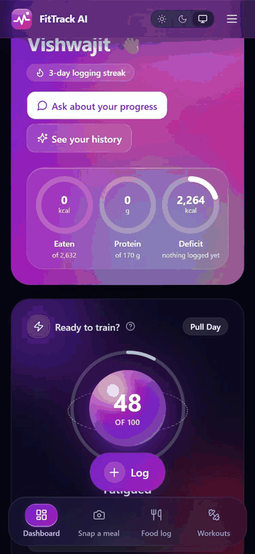

<p align="center">
  
</p>

<h1 align="center">FitTrack AI</h1>

<p align="center"><b>Your personal AI fitness, nutrition and body-feedback coach — running on your own computer.</b></p>

<p align="center">
  
</p>

Snap a photo of your plate and FitTrack AI works out what's on it, roughly how much it weighs, and its calories, protein, carbs, fat and fibre. It tracks your workouts, weight, sleep, energy and bloating, tells you honestly whether you're eating too little or too much, adjusts today's workout to how recovered you are, and can read your blood-test reports.

It uses only **AI services that are free forever** — Google Gemini, Groq, OpenRouter, Cloudflare, NVIDIA, Mistral and Z.ai — with nothing but a free key (no credit card, no trial). If they're all busy, it falls back to AI running on **your own machine** (Ollama).

> ⚠️ FitTrack AI gives fitness and nutrition guidance. It is **not** a doctor. Talk to a medical professional about lab results, symptoms or medication.

---

## Contents

1. [What can it do?](#what-can-it-do)
2. [Feature tour (with GIFs)](#feature-tour)
3. [Quick start (5 minutes, with Docker)](#quick-start-5-minutes-with-docker)
4. [Quick start without Docker](#quick-start-without-docker)
5. [First things to do in the app](#first-things-to-do-in-the-app)
6. [How to use each page](#how-to-use-each-page)
7. [How the numbers are calculated](#how-the-numbers-are-calculated)
8. [AI providers & keys](#ai-providers--keys)
9. [Your data](#your-data)
10. [Backup, seed & move to another computer](#backup-seed--move-to-another-computer)
11. [Project structure](#project-structure-for-developers)
12. [Tech stack](#tech-stack)
13. [Troubleshooting](#troubleshooting)
14. [More documentation](#more-documentation)

---

## What can it do?

| Feature | In plain words |
|---|---|
| 📸 **Snap a meal** | Take a photo. Optionally add ingredients, the container (tiffin, plate, katori…), how full it is, or the exact weight. You get every item with its grams, a calorie *range* (e.g. 380–450 kcal), protein/carbs/fat/fibre, hidden oils and a confidence score. Review, edit, save. |
| 🔎 **Verified nutrition** | AI estimates are cross-checked against a built-in food table, the USDA database and Open Food Facts, so numbers are not just guesses. |
| 🏋️ **Workout log** | Push / Pull / Legs sessions, cardio, sets, reps, weight, RPE. Calories use the standard MET formula and a lifting session is counted **once** — never double-counted per exercise. |
| 🧠 **Smart workout advice** | Each day it suggests today's split and how hard to train (e.g. "70% volume, RPE ≤ 7") based on sleep, energy, soreness, bloating and how much you ate in the last two days. Sundays are rest. |
| 📊 **Daily tracker** | A simple view (calories, protein, weight, deficit) and an **Advanced** view (BMR, NEAT, TEF, exercise, TDEE, meal-by-meal macros, alerts, AI coach). |
| 🚦 **Honest alerts** | 🟥 crash deficit (< 1,000 kcal), 🟨 low protein / fibre, heavy meal right before bed, skipped dinner, short sleep · 🟩 on target. |
| 🫃 **Gut health** | Log bloating, gas, weakness, reflux. It looks for patterns with lactose, gluten, refined flour, late meals, oily food — and tells you when there isn't enough data yet. |
| 🩸 **Medical reports (optional)** | Upload a blood report (PDF or photo) whenever you get one. It extracts each value with its normal range, flags anything high/low, and explains what it could mean for your diet and training. Trends over time. |
| 👤 **Profile** | Basic info up front; an **Advanced** section for body measurements, diet type, allergies, intolerances, conditions, medications, supplements, schedule and targets. |
| 🤖 **7 free AI providers, 54 free models** | Only providers that are free forever with just a key — no card, no trial. 33 models can read photos. Add keys from the web page; if one provider is busy or out of free quota, the next one is used automatically. Ollama (slow, local) is only the last resort. |
| 🦙 **Ollama manager** | Download, list and delete local AI models from the web page, with progress bars. |
| ⚡ **Log a normal day in a few taps** | Saved routines ("Pull day", "Whey after gym", "My usual breakfast"), one-tap quick picks of the foods you actually eat at each meal, "repeat last time" weights with a gentle progression hint, copy yesterday, and Undo on everything. A "Today" checklist tells you what's left to log. |
| 🧠 **Smart without AI (machine learning)** | Small models run on your own computer (free, ~0.23 GB): smarter food search, typing "2 roti and a katori dal" to log a meal, recognising photos of meals you've eaten before, spotting re-uploaded photos, and learning your real portion sizes from your corrections. Statistics learn your **true daily burn** from your weight and food (adaptive TDEE), your weight trend and goal date, training load, what drives your energy, and which foods are linked to bloating. AI is only used when it really adds value. See [docs/ML.md](docs/ML.md). |
| 🥤 **Your protein powder** | Enter your product name and the per-scoop numbers from the tub once (Profile). "+1 scoop" and "1 scoop whey" then log exactly your product. |
| 🍽️ **Meal suggestions** | Tells you what to eat to hit today's protein without blowing calories — respecting vegetarian/eggetarian, intolerances, and light-only food close to bedtime. |
| 💬 **Ask FitTrack** | Ask anything about your own data in plain words — "what did I eat last Monday?", "at this rate, when will I reach my target?", "if I eat 1,800 kcal, how much will I lose in 3 months?". Every number is computed from your logs first; the AI only explains it, and answers are checked so they can't invent numbers. Chats are saved. |
| 🗂️ **History** | Every day you logged in a table (or cards), newest first, with search, filters, sorting and pagination. Tap a day to see what you ate, your workout, weight and how you felt. |
| 🎨 **Aurora Glass design** | Frosted-glass cards, a 3D readiness orb, cards that tilt toward your pointer, smooth animations, light & dark themes, and a phone layout with a floating dock. |
| 💾 **Backup & move** | One command saves *all* your data (incl. chats and photos) and another restores it on any computer — see [Backup, seed & move](#backup-seed--move-to-another-computer). |
| 📁 **Excel / CSV** | `fitness_tracker.xlsx` (6 sheets) and `workout_tracker.csv` are kept up to date automatically, and you can edit the Excel file and import it back. |

Your starting record — **Day 1 (26 Oct 2026, Pull day)** and **Day 2 (27 Oct 2026, Push day)** — is already loaded.

---

## Feature tour

Short loops of the real app. Everything works in **light and dark** themes and on your **phone**.

### 🏠 Dashboard — your day at a glance


- The banner greets you and shows three rings: **eaten** vs your calorie goal, **protein** vs target, and your **deficit**.
- The glowing orb is today's **readiness** (from sleep, energy, soreness and food). Tap *Today's plan* for the workout it suggests.
- Below: your four key numbers with 7-day trend lines, the **Today checklist** (one tap logs your usual meals and routine), quick actions and the things worth fixing today.

### 💬 Ask FitTrack — chat with your own data



1. Open **Ask FitTrack** and tap a suggestion, or type a question in plain words.
2. Ask about a day ("what did I eat yesterday?", "what did I do in the gym 1 week ago?"), your progress ("when will I reach my target?") or a what-if ("if I eat 1,800 kcal a day…").
3. Answers come with tables and the numbers behind them; tap a follow-up chip to keep going. Earlier chats are under **Past chats** — *New chat* never deletes anything.

### 🗂️ History — every day, searchable



1. Search foods, exercises, notes or a weekday ("macaroni", "squat", "monday"); use **Filters** for training days, deficit/surplus, status or weigh-ins; sort by calories, protein, deficit or weight.
2. The tiles on top average whatever matches your search.
3. Tap a row (or a card on phones) to open the day: meals with portions and macros, workout with sets × reps, check-in and flags. *Ask about this day* sends it to the chat.

### 🍽️ Food log — log a normal day in a few taps



- Rings show calories and protein against your targets; the bar shows your macro split.
- **Add what you usually eat**: pick a meal tab and tap your usual foods — one tap each. Saved meals log several foods at once.
- **Quick add by typing**: write "2 roti, 1 katori dal and a scoop of whey" and press *Read it* — no AI needed.
- **+1 scoop** logs your protein powder exactly as saved in Profile. Everything can be undone.

### 📸 Snap a meal — photo to calories



1. Take a photo (or upload / drag one in), or just describe the meal.
2. Optional extras make it more accurate: ingredients, the container (plate, katori, tiffin…), how full it is, or the weight.
3. Press **Analyse meal**, check the items and their confidence, fix anything, then **Save to your food log**.

### 🏋️ Workouts — your routine in taps



- The banner shows today's split and how hard to train, with your readiness ring.
- **Log workout** → pick your routine; last time's weights are pre-filled with a gentle progression hint.
- Every session lists its exercises with sets, reps, weight and effort; cardio has its own card. Calories are counted once per session.

### 💜 Check-in & gut health — 10 seconds each morning



1. Weight and hours slept, then tap a face for sleep, energy, mood and stress — that's it.
2. Log a symptom (bloating, gas, reflux…) whenever it happens; FitTrack looks for links with your meals.
3. The check-in shapes today's readiness and workout advice.

### 🧠 Insights — what your data says



- Your smoothed **trend weight**, how fast you're losing and your **goal date**.
- Your **real calorie burn**, learned from your food and weight (gets more confident every week).
- Training load, what drives your energy, meal suggestions and data checks.

### 🌗 Light & dark, profile and AI keys



- Switch **Light / Dark / System** at the bottom of the sidebar (or the top bar on phones).
- **Profile**: your details, weight journey and targets. Age and sex are needed for accurate calories.
- **AI providers & keys**: add a free key (Google Gemini is a great start), test it, and FitTrack routes between free providers automatically.

### 📱 On your phone

<p></p>

- Open `http://<your-computer's-IP>:3000` on the same Wi-Fi.
- The floating dock has your four main pages; the **Log** button opens one-tap logging for meals, scoops, workouts, weight, water, symptoms and photos (shortcut **N** on a keyboard).


---

## Quick start (5 minutes, with Docker)

**You need:** [Docker Desktop](https://www.docker.com/products/docker-desktop/) (Windows / Mac / Linux). Nothing else.

**1. Open a terminal in the project folder** (the folder that contains this README).

**2. Create the settings files** (copies of the examples):

```bash
cp backend/.env.example backend/.env
```

```bash
cp frontend/.env.example frontend/.env
```

> On Windows Command Prompt use `copy` instead of `cp`, e.g. `copy backend\.env.example backend\.env`.

**3. Pick a secret password for your data.** Open `backend/.env` in any text editor and replace `change-me-to-a-long-random-string` after `SECRET_KEY=` with any long random text (a mix of letters and numbers, 40+ characters). It protects the AI keys you'll save later.

**4. Start everything:**

```bash
docker compose up -d --build
```

The first run downloads and builds everything — allow 3–10 minutes.

**5. Open the app:** http://localhost:3000 🎉

| What | Address |
|---|---|
| The app | http://localhost:3000 |
| Backend API + interactive docs | http://localhost:8000/docs |

Want free AI that runs entirely on your computer as well?

```bash
docker compose --profile ollama up -d --build
```

Stop the app with `docker compose down`. Your data stays saved and returns the next time you start it.

---

## Quick start without Docker

**You need:** [Python 3.11+](https://www.python.org/downloads/) and [Node.js 20+](https://nodejs.org/).
PostgreSQL, Redis and Ollama are optional.

**Backend** (terminal 1):

```bash
cd backend
cp .env.example .env
python -m venv .venv
```

Activate it — Windows: `.venv\Scripts\activate` · macOS/Linux: `source .venv/bin/activate` — then:

```bash
pip install -r requirements.txt
uvicorn app.main:app --reload --port 8000
```

> **No PostgreSQL installed?** In `backend/.env`, change the `DATABASE_URL` line to
> `DATABASE_URL=sqlite+aiosqlite:///./data/fittrack.db` and set `REDIS_URL=` (empty). That's it — no database server needed.

**Frontend** (terminal 2):

```bash
cd frontend
cp .env.example .env
npm install
npm run dev
```

Open http://localhost:3000.

The database tables are created automatically (via migrations) the first time the backend starts.

---

## First things to do in the app

1. **Profile → add your age and sex.** Until you do, BMR, TDEE and your true deficit show "Pending Biometric Confirmation".
2. **AI Providers → add free keys.** Start with Google Gemini (best at reading food photos): https://aistudio.google.com/app/apikey. Add Groq (https://console.groq.com/keys, very fast) and OpenRouter (https://openrouter.ai/keys) as backups. Paste each key and press **Test**. All of them are free with no credit card.
3. **Check-in → log this morning's weight, sleep and energy.**
4. **Snap a meal** with your phone (open `http://<your-computer's-IP>:3000` on the same Wi-Fi — see [Troubleshooting](#troubleshooting)).

---

## How to use each page

| Page | What to do there |
|---|---|
| **Dashboard** | Today at a glance: calories eaten vs burned, protein vs target, deficit, readiness orb, today's checklist, alerts, quick actions. |
| **Ask FitTrack** | Type a question about your data in plain words; answers use your real logs. Past chats are kept. |
| **History** | Every logged day in a table or cards: search, filter, sort, then tap a day for the full picture. |
| **Food log** | See meals by day, add food manually (with search), edit or delete. |
| **Snap meal** | Tap the camera, take a photo, optionally fill in extras, press **Analyze**, check the items, press **Save**. Tips: shoot from ~45° with the whole container visible; choose the container type; enter the weight if you have a kitchen scale. |
| **Workouts** | Add a session (Push / Pull / Legs + duration), cardio (minutes + intensity) and exercises (sets × reps × kg). See today's recommendation. |
| **Tracker** | Basic daily numbers. Flip **Advanced** for the full breakdown, per-meal macros and the AI coach. Trends tab for 7/14/30-day tables. |
| **Check-in** | Morning weight, sleep, energy, soreness, bloating, steps, water. Log symptoms any time. See gut-health patterns. |
| **Medical** | Upload a lab report when you have one. Not a daily task. |
| **Profile** | Basic details; open **Advanced** for everything else. |
| **AI Providers** | Keys, on/off switches, priority order, models, routing, a test playground and a log of every AI call. |
| **Ollama** | Local AI: status, download models (progress bar), delete models. |
| **Insights (ML)** | Weight trend & goal date, your real daily burn (adaptive TDEE), training load, what drives your energy, meal suggestions, data-quality warnings. |
| **Settings** | USDA / Tavily keys, machine-learning models, download Excel/CSV/JSON backup, import Excel, restore a JSON backup. |

---

## How the numbers are calculated

- **BMR** (calories your body burns at rest) — Mifflin-St Jeor: men `10×kg + 6.25×cm − 5×age + 5`, women `… − 161`.
- **Exercise** — `MET × 3.5 × kg ÷ 200 × minutes`. Treadmill walk ≈ 4.5, cycling ≈ 5.5, weight training ≈ 4.0.
- **NEAT** (everyday movement) — from your steps, or a lifestyle estimate.
- **TEF** (energy used digesting food) — 25% of protein calories, 7.5% of carbs, 2% of fat.
- **TDEE** = BMR + NEAT + TEF + exercise.
- **Deficit** = TDEE − what you ate. (Never "food minus exercise".)
- **Protein target** = 1.6–2.0 g per kg of body weight.

Example — Day 1: 20 min treadmill (149 kcal) + 10 min cycling (91 kcal) + 60 min lifting (397 kcal) = **637 kcal** of exercise. Details: [docs/CALCULATIONS.md](docs/CALCULATIONS.md).

---

## AI providers & keys

- Keys are entered on the **AI Providers** page and stored **encrypted**. The page only ever shows a masked preview.
- You can also put keys in `backend/.env` (e.g. `GROQ_API_KEY=…`); keys saved in the app take priority.
- Only **free-forever** providers are included: Gemini, Groq, OpenRouter (`:free` models), Cloudflare Workers AI, NVIDIA NIM, Mistral (free plan, off by default because it trains on prompts) and Z.ai. Paid and trial-only services were removed on purpose.
- Order of attempts: your pinned models → cloud providers by priority → **Ollama last**. When a free quota runs out (HTTP 429) that model cools down and the next one is used; providers with a wrong key are skipped.
- Full provider list and routing rules: [docs/AI_PROVIDERS.md](docs/AI_PROVIDERS.md).

---

## Your data

- Everything is stored in your own database (PostgreSQL in Docker, or a single SQLite file).
- Photos and reports are saved in `backend/data/uploads` (or the `backend_data` Docker volume).
- `fitness_tracker.xlsx` (Daily Summary, Food Log, Workout Log, Body Weight, Nutrition Targets, Weekly Report) and `workout_tracker.csv` are refreshed automatically in `backend/data/exports` and can be downloaded from **Settings**.
- Edit the Excel file (saved as `.xlsx` or `.xlsm`) and **Import** it back from **Settings → Your data**: rows with an ID
  are updated, new rows are added, nothing is deleted. Words typed in Excel ("Lunch", "6:30 PM", "1,279") are understood;
  rows with mistakes (a negative number, an unreadable date) are skipped and listed so you can fix them, and the rest is saved.
- **Full JSON backup**: one file with everything you logged (profile, days, food, workouts, symptoms, reports, routines
  and Ask FitTrack chats). **Restore from JSON backup** shows what's inside first, saves a safety copy of your current data
  (listed under *Safety copies*, downloadable), then replaces your data in one step — if anything in the file is wrong,
  nothing changes. AI keys and settings stay on the install; photos are not inside the JSON (use the snapshot below for those).
- The app has no login. Run it on your own computer or private network only.

### Tests

```bash
# unit tests (no database needed)
cd backend && pip install -r requirements.txt -r requirements-dev.txt && pytest tests

# import / backup scenarios against a RUNNING throwaway backend — they write data, never point them at your real one
FITTRACK_TEST_API=http://localhost:8001 pytest tests/test_portability_api.py
```

---

## Backup, seed & move to another computer

FitTrack AI has a **full-data seeder**: one command saves *everything* — every table (profile, food, workouts,
check-ins, symptoms, medical reports and biomarkers, presets, AI providers/models/routing, saved keys, AI call logs,
the food library and **every Ask FitTrack chat**) plus every uploaded photo and report — into
`backend/app/db/seed/snapshot/`. Another command puts it all back on any machine, with the same ids, so the app
continues exactly where you left off.

```
backend/app/db/seed/snapshot/
├── manifest.json        when it was taken, schema version, rows per table
├── data/<table>.json    one file per table, one row per line
└── uploads/             copy of data/uploads (meal photos, lab reports)
```

### 1. Save a snapshot (on the old computer)

Open **Ask FitTrack** once in the browser you chat in first: older chats that were kept only in that browser are
moved to the database automatically. Then:

```bash
docker compose exec backend python -m app.db.seed.snapshot dump
```

Without Docker (from `backend/`, with the virtualenv active):

```bash
python -m app.db.seed.snapshot dump
```

Re-run it whenever you want a fresh copy — it replaces the previous snapshot. Copy the whole project folder
(including `backend/app/db/seed/snapshot/`) **and your `backend/.env`** to the new computer.

> The snapshot contains your personal health data and your AI keys (encrypted). Keep it private — don't push it to a
> public repository.

### 2. Restore it (on the new computer)

1. Copy `backend/.env` from the old computer — it must have the **same `SECRET_KEY`**, otherwise saved AI keys can't
   be decrypted (you'd simply re-enter them in **AI providers & keys**).
2. Start the app once so the database exists:

   ```bash
   docker compose up -d --build
   ```

3. Restore everything (this first applies all migrations, then wipes the starter data and loads your snapshot):

   ```bash
   docker compose exec backend python -m app.db.seed.snapshot load --replace
   ```

   Without Docker (from `backend/`):

   ```bash
   python -m app.db.seed.snapshot load --replace
   ```

Without `--replace` the load refuses to touch a database that already has data. Options: `--dir <folder>` to use
another snapshot folder, `--no-uploads` to skip the files. Not included (re-created automatically): the on-device
ML models in `data/models` (re-downloaded) and the Excel/CSV exports in `data/exports` (regenerated).

### Database migrations

Migrations run automatically when the backend starts. To run them by hand or to change the schema:

```bash
docker compose exec backend alembic upgrade head
```

```bash
docker compose exec backend alembic revision --autogenerate -m "describe the change"
```

```bash
docker compose exec backend alembic check
```

Without Docker run the same `alembic …` commands from `backend/`. After a schema change, take a new snapshot; a
snapshot taken before a new table existed still loads (the new table simply starts empty).

The small built-in starter data (profile + the first two logged days, starter presets, food library, AI catalog) is
created by `python -m app.db.seed` and also runs automatically on first start — the snapshot is what you use to keep
*your* data.

---

## Project structure (for developers)

```
FitTrack AI/
├── backend/                     FastAPI service (all server logic)
│   ├── app/
│   │   ├── api/routes/          HTTP endpoints (thin)
│   │   ├── core/                settings, encryption, cache
│   │   ├── db/                  engine, base types, Alembic migrations, seed data
│   │   ├── models/              SQLAlchemy tables (one file per domain)
│   │   ├── schemas/             Pydantic request bodies
│   │   └── services/            business logic: science, tracker, coach, training,
│   │                            nutrition, health, llm, ollama, data
│   ├── scripts/                 maintenance scripts
│   ├── alembic.ini · requirements.txt · Dockerfile
│   └── .env.example             every backend setting (copy to .env)
├── frontend/                    Next.js 14 app (all UI)
│   ├── src/app/                 one folder per page
│   ├── src/components/<feature> UI per feature + ui/ primitives
│   ├── src/hooks · src/lib · src/config
│   ├── Dockerfile
│   └── .env.example             frontend settings (copy to .env)
├── docs/                        guides, API contract, calculations
│   └── diagram/                 Mermaid flows (.mmd) + database schema (.drawio)
├── .claude/                     Claude Code agents & skills for this project
├── CLAUDE.md                    project memory for Claude Code
└── docker-compose.yml           db + redis + backend + frontend (+ ollama profile)
```

---

## Tech stack

| Layer | Technology |
|---|---|
| Frontend | Next.js 14 (App Router, TypeScript), Tailwind CSS, shadcn-style components, Lucide icons, Recharts, SWR, SweetAlert2, Sonner |
| Backend | Python, FastAPI, Pydantic v2, SQLAlchemy 2 (async), Alembic, httpx |
| Database | PostgreSQL 16 + pgvector (or SQLite), Redis 7 |
| AI | Custom multi-provider router (OpenAI-compatible APIs) + Ollama |
| Machine learning | ONNX Runtime via fastembed (Nomic Embed text + vision), NumPy/SciPy: Kalman filter, ridge regression, Bayesian beta-binomial, MILP, pHash |
| Data sources | USDA FoodData Central, Open Food Facts, Tavily (optional) |
| Packaging | Docker Compose, multi-stage Dockerfiles (uv for Python) |

---

## Troubleshooting

| Problem | Fix |
|---|---|
| Page says it can't reach the backend | Is http://localhost:8000/api/health OK? With Docker: `docker compose logs backend`. |
| "All AI providers failed" | Add a key on **AI Providers** and press **Test**. The **Call logs** tab shows the exact reason. |
| Use it from your phone | Find your computer's local IP (e.g. `192.168.1.20`). Set `NEXT_PUBLIC_API_URL=http://192.168.1.20:8000` in `frontend/.env` and add `http://192.168.1.20:3000` to `CORS_ORIGINS` in `backend/.env`, then rebuild: `PUBLIC_API_URL=http://192.168.1.20:8000 docker compose up -d --build`. Open `http://192.168.1.20:3000` on the phone. |
| A port is already in use | e.g. `BACKEND_HOST_PORT=8001 FRONTEND_HOST_PORT=3001 docker compose up -d` |
| Saved AI keys stopped working | `SECRET_KEY` was changed — enter the keys again. |
| Start completely fresh | `docker compose down -v` (deletes all data!) then `docker compose up -d --build`. |

---

## More documentation

| Document | About |
|---|---|
| [docs/SETUP.md](docs/SETUP.md) | Detailed setup, Docker and non-Docker, migrations |
| [docs/ARCHITECTURE.md](docs/ARCHITECTURE.md) | How the code is organised and why |
| [docs/API.md](docs/API.md) | Every REST endpoint and JSON shape |
| [docs/CALCULATIONS.md](docs/CALCULATIONS.md) | Formulas, alert rules, readiness, gut-health statistics |
| [docs/FOOD_PHOTO_ANALYSIS.md](docs/FOOD_PHOTO_ANALYSIS.md) | How photo → grams → macros works |
| [docs/AI_PROVIDERS.md](docs/AI_PROVIDERS.md) | Providers, models, fallback routing, Ollama |
| [docs/ML.md](docs/ML.md) | On-device machine learning: what runs locally, algorithms, limits |
| [docs/DATABASE.md](docs/DATABASE.md) | Tables, migrations, seed data |
| [docs/diagram/](docs/diagram/) | Architecture, flows and database diagrams |
